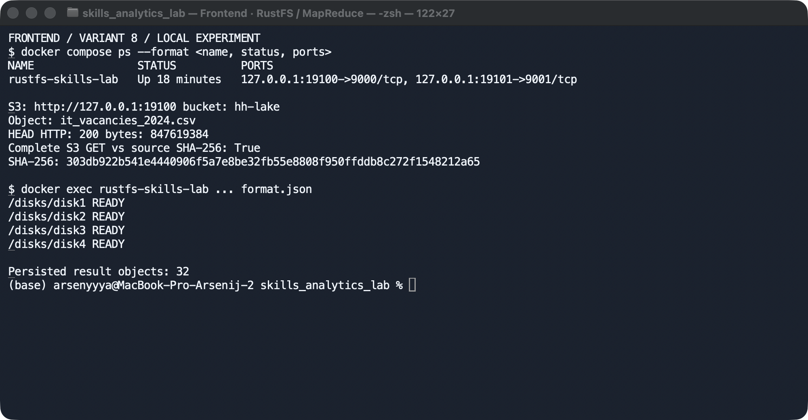
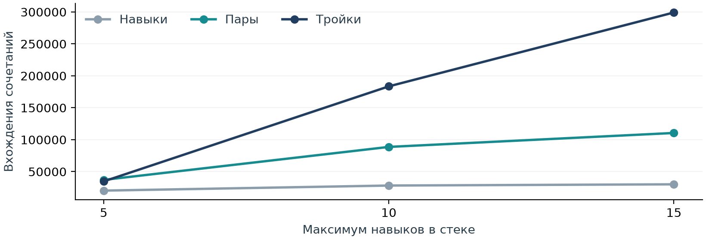
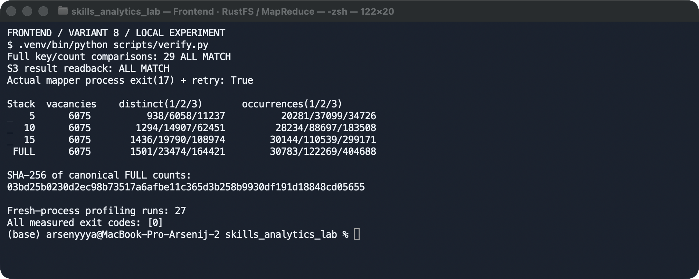
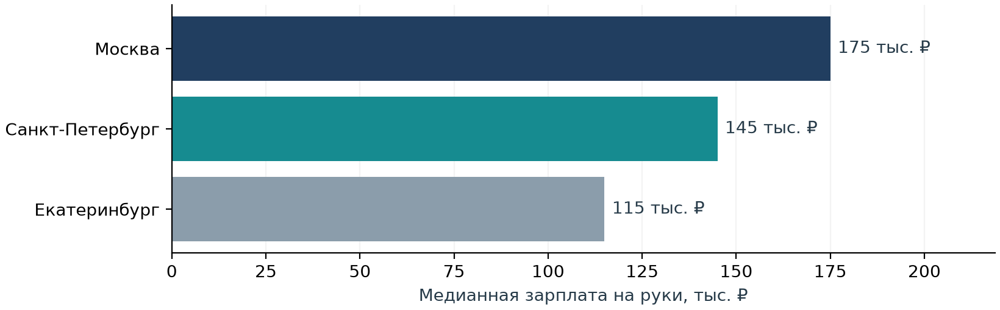

# Анализ Frontend-вакансий

Вариант 8 · Программист, разработчик Frontend · 21 октября 2026

Репозиторий: [https://github.com/Arsenyyya/VK_ed_hw](https://github.com/Arsenyyya/VK_ed_hw).

Для работы я взял вакансии Frontend-разработчиков, посчитал навыки двумя способами — своим MapReduce и SQL в DuckDB — и сравнил результаты. После этого разобрался, как набор навыков связан с зарплатой и чем отличаются вакансии в трёх городах.

В выборку вошли 6 075 вакансий. У 4 571 указаны навыки, а 1 855 подходят для сравнения зарплат.

## Какие вакансии вошли

Использовал файл `it_vacancies_2024.csv` из прошлой лабораторной. В нём 229 388 строк, повторяющихся ID нет. Вакансии опубликованы с 2023-12-19 по 2024-09-14, данные собраны с 2024-08-23 по 2024-09-15. Выводы относятся к этому набору вакансий.

Мой фильтр в SQL:

```sql
WHERE role = 'Программист, разработчик'
  AND regexp_matches(name,
      'front[ -]?end|фронт[ -]?[еэ]нд', 'i')
```

Оставил роль «Программист, разработчик» и названия со словом Frontend, Front-end, Front end или его русским написанием. В MapReduce такой же фильтр написал через `re`.

| Проверка данных | Результат |
| --- | --- |
| Вакансии варианта 8 | 6 075 |
| С указанными навыками | 4 571 (75,2%) |
| Без навыков; в региональных итогах учтены | 1 504 |
| Медианный / максимальный размер полного стека | 5 / 30 |
| Зарплата: рубли на руки | 1 855 (30,5%) |
| Медиана сопоставимых зарплат | 140 000 ₽ |

Зарплаты сравнивал в рублях на руки: RUR/RUB, `gross=false`, сумма больше нуля. Если указан диапазон, брал его середину, если одну границу — её значение. У 3 545 вакансий зарплаты нет, у 540 указана сумма до налогов, ещё у 135 — другая валюта. В исходнике также есть 2 суммы ниже 10 000 ₽. Оставил их без изменений; они входят в расчёт медианы.

<!-- pagebreak -->

## Хранилище и загрузка данных

RustFS запустил в отдельном контейнере с четырьмя папками вместо дисков. Все папки находятся на одном накопителе. Настройки сохранил в `compose.yaml`.

| Параметр | Значение |
| --- | --- |
| Сервер | RustFS 1.0.1, образ закреплён по SHA-256 digest |
| Адрес S3 / консоли | 127.0.0.1:19100 / 127.0.0.1:19101 |
| Bucket и объект | hh-lake / it_vacancies_2024.csv |
| Размер объекта | 847 619 384 байт |
| PUT / полный GET | HTTP 200 / HTTP 200, SHA-256 совпал |

```bash
docker compose up -d
.venv/bin/python scripts/storage.py
```



SHA-256 исходного файла и обратного чтения:

```text
303db922b541e4440906f5a7e8be32fb55e8808f950ffddb8c272f1548212a65
```

После загрузки полностью прочитал объект через S3 и сравнил SHA-256 с исходным файлом — хеши совпали. Вывод команды сохранил в `logs/upload-terminal.log`, параметры загрузки — в `logs/storage.json`. Результаты всех запусков для трёх размеров стека лежат в `s3://hh-lake/results/`.

<!-- pagebreak -->

## Как считаются навыки, пары и тройки

Частоту считал по числу вакансий с навыком или сочетанием. Навыки разделил по `;`, убрал лишние пробелы, привёл названия к нижнему регистру и удалил повторы внутри вакансии. Разные написания, например `html` и `html5` или `react` и `react.js`, оставил отдельно.

Порядок навыков не важен: JavaScript + React и React + JavaScript — одна и та же пара. Вакансии без навыков учитывал в общей численности.

### Свой MapReduce

В `scripts/mapreduce.py` файл читается прямо из S3 с буфером 1 МиБ и разбивается на чанки по 1000 строк. Переносы внутри кавычек обрабатывает CSV-парсер. Для подсчёта использовал 4 процесса маппера, одновременно в работе — до 8 чанков.

```python
skills = sorted({x.strip().lower()
                 for x in raw.split(';') if x.strip()})
for size in (1, 2, 3):
    partial.update(combinations(skills, size))
# редьюсер суммирует частоты из готовых чанков
```

В первой версии сначала собирал все ключи, затем суммировал их частоты. В улучшенной версии маппер сразу объединяет повторы через `Counter`, а редьюсер добавляет результаты готовых чанков в общий счётчик.

### Проверка через DuckDB

Для второго способа написал SQL-запросы. DuckDB читает тот же `s3://hh-lake/it_vacancies_2024.csv` через расширение `httpfs` и считает частоты отдельно от MapReduce. Подготовка данных находится в `sql/prepare.sql`, подсчёт — в `sql/count.sql`.

```sql
SELECT [a.skill, b.skill], count(*)
FROM skill_rows a JOIN skill_rows b
  ON a.vacancy_id = b.vacancy_id AND a.skill < b.skill
GROUP BY a.skill, b.skill;
-- для троек добавляется c с условием b.skill < c.skill
```

Одиночные навыки считаются через `GROUP BY`. Для пар таблица навыков соединяется сама с собой по ID вакансии, для троек добавляется ещё одно соединение. Условие `a.skill < b.skill` убирает повторные перестановки. Фильтр варианта хранится в `config.json` и передаётся в запрос.

<!-- pagebreak -->

## Самые частые навыки и сочетания

Здесь использовал все навыки вакансии, без ограничения размера стека. Ниже — по пять самых частых навыков, пар и троек. Доли посчитаны от всех 6 075 вакансий варианта.

### Одиночные навыки

| Навык / сочетание | Вакансий | Доля всех Frontend |
| --- | --- | --- |
| JavaScript | 3 202 | 52,7% |
| TypeScript | 2 344 | 38,6% |
| React | 1 966 | 32,4% |
| Git | 1 690 | 27,8% |
| HTML | 1 332 | 21,9% |

### Пары

| Навык / сочетание | Вакансий | Доля всех Frontend |
| --- | --- | --- |
| JavaScript + TypeScript | 1 657 | 27,3% |
| JavaScript + React | 1 414 | 23,3% |
| React + TypeScript | 1 326 | 21,8% |
| Git + JavaScript | 1 300 | 21,4% |
| HTML + JavaScript | 1 062 | 17,5% |

### Тройки

| Навык / сочетание | Вакансий | Доля всех Frontend |
| --- | --- | --- |
| JavaScript + React + TypeScript | 950 | 15,6% |
| CSS + HTML + JavaScript | 690 | 11,4% |
| Git + JavaScript + TypeScript | 607 | 10,0% |
| CSS3 + HTML5 + JavaScript | 569 | 9,4% |
| Git + JavaScript + React | 557 | 9,2% |

На первом месте JavaScript — он указан более чем в половине вакансий. Самая частая пара — JavaScript + TypeScript, а самая частая тройка — JavaScript + React + TypeScript. Полные результаты сохранил в `results/skill_frequencies.csv`.

<!-- pagebreak -->

## Размер стека и проверка результатов

Чтобы посмотреть, как растёт число сочетаний, сделал три запуска с ограничением стека: 5, 10, 15 навыков. Сначала сортировал названия по алфавиту, затем брал первые навыки до лимита. Если их меньше, оставлял все. Для анализа зарплат и регионов использовал полные стеки.

| Лимит стека | Навыки: вхождения | Пары: вхождения | Тройки: вхождения |
| --- | --- | --- | --- |
| 5 | 20 281 | 37 099 | 34 726 |
| 10 | 28 234 | 88 697 | 183 508 |
| 15 | 30 144 | 110 539 | 299 171 |
| Полный | 30 783 | 122 269 | 404 688 |

Вакансия с m навыками даёт m одиночных ключей, C(m,2) = m(m−1)/2 пар и C(m,3) = m(m−1)(m−2)/6 троек. Например:

| m | Одиночных | Пар | Троек |
| --- | --- | --- | --- |
| 5 | 5 | 10 | 10 |
| 10 | 10 | 45 | 120 |
| 15 | 15 | 105 | 455 |

При росте лимита с 5 до 15 фактическое число пар выросло в 2,98 раза, троек — в 8,62 раза. Рост слабее, чем у одной вакансии с ровно m навыками: у многих вакансий стек короче лимита и остаётся прежним.



Для каждого запуска сравнил все сочетания и их частоты в MapReduce и DuckDB. Всего получилось 29 сравнений: три размера стека, все режимы и повторы, полный стек и запуск после отказа. Расхождений нет. Сохранённые JSON также прочитал обратно из S3 и проверил их содержимое.

В полном стеке получилось 1 501 разных навыков, 23 474 пар и 164 421 троек. SHA-256 отсортированной таблицы результатов:

```text
03bd25b0230d2ec98b73517a6afbe11c365d3b258b9930df191d18848cd05655
```

<!-- pagebreak -->

## Сравнение времени и памяти

Замеры выполнил на macOS-26.6.2-arm64-arm-64bit: 10 логических CPU и 16 ГиБ памяти. MapReduce работал в 4 процессах с чанками по 1000 строк, DuckDB — в 4 потоках с лимитом памяти 2 ГБ. Каждый режим запускал по три раза в отдельном Python-процессе. Замерял весь запуск, от чтения S3 до сохранения результата.

Память оценивал по пику суммы RSS клиентских процессов с опросом каждые 10 мс. Потребление Docker и RustFS в этот замер не входит. Такой замер может повторно учитывать общие страницы и пропускать короткие пики. Запуски шли по очереди; кеши не сбрасывал, порядок режимов между попытками менял.

### Все 27 измерений

В каждой ячейке перечислены попытки 1 / 2 / 3. МиБ = 1 048 576 байт.

| Лимит | Режим | Время, с · 1 / 2 / 3 | Пик RSS, МиБ · 1 / 2 / 3 |
| --- | --- | --- | --- |
| 5 | MR исходный | 7,84 / 8,22 / 7,90 | 293,5 / 296,3 / 298,4 |
| 5 | MR с combiner | 8,17 / 8,99 / 7,19 | 276,3 / 293,4 / 291,0 |
| 5 | DuckDB SQL | 11,36 / 10,69 / 9,77 | 1 193,5 / 1 197,1 / 1 678,3 |
| 10 | MR исходный | 9,20 / 8,58 / 8,34 | 310,7 / 312,4 / 312,8 |
| 10 | MR с combiner | 9,38 / 8,64 / 8,13 | 285,2 / 289,6 / 298,4 |
| 10 | DuckDB SQL | 11,52 / 19,21 / 9,85 | 1 111,5 / 1 097,4 / 1 621,9 |
| 15 | MR исходный | 9,33 / 8,97 / 9,21 | 318,6 / 319,4 / 325,1 |
| 15 | MR с combiner | 10,33 / 7,15 / 8,71 | 280,3 / 308,8 / 310,2 |
| 15 | DuckDB SQL | 15,21 / 9,63 / 11,27 | 878,8 / 1 675,7 / 1 665,5 |

### Медианы трёх попыток

| Лимит | Режим | Время, с | Пик RSS, МиБ |
| --- | --- | --- | --- |
| 5 | MR исходный | 7,90 | 296,3 |
| 5 | MR с combiner | 8,17 | 291,0 |
| 5 | DuckDB SQL | 10,69 | 1 197,1 |
| 10 | MR исходный | 8,58 | 312,4 |
| 10 | MR с combiner | 8,64 | 289,6 |
| 10 | DuckDB SQL | 11,52 | 1 111,5 |
| 15 | MR исходный | 9,21 | 319,4 |
| 15 | MR с combiner | 8,71 | 308,8 |
| 15 | DuckDB SQL | 11,27 | 1 665,5 |

При лимите 15 DuckDB работал в 1,29 раза дольше, чем MR с combiner, и потреблял больше памяти. На результат влияют чтение CSV, буферы и промежуточные таблицы; отдельно их вклад я не измерял. Между попытками есть разброс, поэтому сравнение относится к этому стенду и этому файлу. Подробные замеры — в `logs/benchmark.json`.

<!-- pagebreak -->

## Оптимизация и проверка отказа маппера

Для оптимизации добавил в маппер локальный `Counter`. Он объединяет одинаковые сочетания до передачи редьюсеру. Редьюсер сразу складывает частоты готовых чанков, поэтому хранить весь список ключей уже не нужно. Источник данных, число процессов и размер чанка оставил прежними.

| Лимит | Время до → после, с | RSS до → после, МиБ | Экономия времени | Экономия памяти |
| --- | --- | --- | --- | --- |
| 5 | 7,90 → 8,17 | 296,3 → 291,0 | -3,5% | 1,8% |
| 10 | 8,58 → 8,64 | 312,4 → 289,6 | -0,7% | 7,3% |
| 15 | 9,21 → 8,71 | 319,4 → 308,8 | 5,3% | 3,3% |

В таблице приведены медианы трёх запусков. Отрицательный процент означает, что после изменения стало хуже. Памяти во всех случаях потребовалось меньше, а по времени выигрыш получился только при стеке до 15 навыков. На коротких стеках разница во времени невелика по сравнению с разбросом между попытками.

### Проверка восстановления

Чтобы проверить обработку отказа, завершил первый процесс маппера через `os._exit(17)`. После ошибки `BrokenProcessPool` программа отбрасывает частичный результат, создаёт новые процессы и один раз повторяет расчёт с чтением S3 с начала. Итоговый JSON записывается после успешного завершения, поэтому частоты не удваиваются.

```bash
.venv/bin/python scripts/mapreduce.py --cap 0 \
  --run recovery --fail-worker
.venv/bin/python scripts/verify.py
```



После повтора результат совпал с обычным запуском и с DuckDB. Журнал отказа и повторного запуска — `logs/recovery.log`, сведения об ошибке также есть в поле `recovery` итогового JSON. В этой реализации расчёт после сбоя начинается заново.

<!-- pagebreak -->

## Зарплата и пары навыков

Медиана по 1 855 вакансиям с сопоставимой зарплатой — **140 000 ₽**. Для сравнения оставил сочетания хотя бы с 10 зарплатами. Частоту навыков при выборе базы считал по всем 6 075 вакансиям.

Для пары A+B брал за базу более частый навык и сравнивал медиану вакансий с ним с медианой вакансий, где есть оба навыка. Базовая группа включает вакансии с сочетанием. При равных частотах выбирал навык по алфавиту. Разницу считал так: Δ = медиана сочетания − медиана базы; Δ% = 100 × (медиана сочетания / медиана базы − 1).

Ниже — по три пары с наибольшей положительной и отрицательной разницей в рублях. `n` — число вакансий с зарплатой в соответствующей группе.

| Сочетание | База: медиана / n | Сочетание: медиана / n | Разница |
| --- | --- | --- | --- |
| Выше: REST + ООП | REST; 150 000 ₽; n=132 | 300 000 ₽; n=12 | +150 000 ₽; +100,0% |
| Выше: CSS3 + RxJS | CSS3; 120 000 ₽; n=449 | 230 000 ₽; n=10 | +110 000 ₽; +91,7% |
| Выше: Git + RxJS | Git; 125 000 ₽; n=681 | 230 000 ₽; n=15 | +105 000 ₽; +84,0% |
| Ниже: JavaScript + MS SQL | JavaScript; 130 000 ₽; n=1098 | 45 000 ₽; n=14 | -85 000 ₽; -65,4% |
| Ниже: C# + JavaScript | JavaScript; 130 000 ₽; n=1098 | 49 500 ₽; n=11 | -80 500 ₽; -61,9% |
| Ниже: JavaScript + JSON | JavaScript; 130 000 ₽; n=1098 | 55 000 ₽; n=16 | -75 000 ₽; -57,7% |

Полная таблица с частотами — в `results/salary_effects.csv`. Например, REST указан в 295 вакансиях, REST + ООП — в 13; зарплата есть у 132 и 12 из них. JavaScript встречается в 3202 вакансиях, JavaScript + MS SQL — в 19; для медиан использованы 1098 и 14 зарплат.

Самые большие прибавки получились у редких сочетаний: REST + ООП и пар с RxJS. Выборки небольшие, поэтому на медиану может сильно влиять состав вакансий. У пар с MS SQL, C# и JSON медианы ниже базовой. Возможные причины — другой уровень позиций и требования к опыту; по одним названиям навыков их отделить нельзя.

<!-- pagebreak -->

## Зарплата и тройки навыков

Для тройки взял за базу самую частую из входящих в неё пар. Так можно сравнить пару навыков с тем же набором и ещё одним навыком. Для базы оставил то же ограничение — хотя бы 10 вакансий с зарплатой.

| Сочетание | База: медиана / n | Сочетание: медиана / n | Разница |
| --- | --- | --- | --- |
| Выше: Git + Webpack + ООП | Git + Webpack; 140 000 ₽; n=122 | 300 000 ₽; n=13 | +160 000 ₽; +114,3% |
| Выше: Git + REST + ООП | Git + REST; 150 000 ₽; n=85 | 300 000 ₽; n=12 | +150 000 ₽; +100,0% |
| Выше: TypeScript + Webpack + ООП | TypeScript + Webpack; 160 000 ₽; n=118 | 300 000 ₽; n=12 | +140 000 ₽; +87,5% |
| Ниже: API + Git + REST | Git + REST; 150 000 ₽; n=85 | 67 500 ₽; n=14 | -82 500 ₽; -55,0% |
| Ниже: Angular + AngularJS + JavaScript | Angular + JavaScript; 200 000 ₽; n=80 | 120 000 ₽; n=11 | -80 000 ₽; -40,0% |
| Ниже: API + CSS3 + TypeScript | CSS3 + TypeScript; 150 000 ₽; n=191 | 70 000 ₽; n=10 | -80 000 ₽; -53,3% |

Самая большая прибавка получилась у Git + Webpack + ООП: 300 000 ₽ против 140 000 ₽ у пары Git + Webpack. Пара встречается в 225 вакансиях, тройка — в 17; зарплата есть у 122 и 13 из них.

У API + Git + REST медиана 67 500 ₽ против 150 000 ₽ у более частой пары Git + REST: −82 500 ₽. Зарплатная выборка тройки — 14 наблюдений, базы — 85.

### Как я понимаю эти результаты

Посмотрел требования к опыту. У вакансий с зарплатой и сочетанием Git + Webpack + ООП: От 3 до 6 лет — 11; От 1 года до 3 лет — 2. У API + Git + REST: От 1 года до 3 лет — 11; От 3 до 6 лет — 2; Нет опыта — 1. В дорогой группе чаще нужен опыт 3–6 лет, в дешёвой — 1–3 года. Это может объяснять часть разницы.

Кроме навыков, на зарплату влияют опыт, компания и регион. Поэтому Δ показывает разницу между группами вакансий, а не гарантированную прибавку за изучение технологии. Особенно это касается сочетаний, где зарплат всего 10–15.

В итоговой таблице — 875 пар и 2046 троек. Для каждой сохранены база, частоты, обе медианы, размеры выборок и разница в рублях и процентах.

<!-- pagebreak -->

## Сравнение зарплат в трёх городах

Для сравнения выбрал Москву, Санкт-Петербург и Екатеринбург. Город определял по точному значению `area`, области отдельно не добавлял. Учитывал все вакансии своего варианта, в том числе без навыков. Зарплаты отбирал по тем же правилам, что и выше.

| Регион | Вакансий | С навыками | Зарплат, n | Доля с зарплатой | Медиана, ₽ | Q25–Q75, ₽ |
| --- | --- | --- | --- | --- | --- | --- |
| Москва | 2 775 | 2 004 | 696 | 25,1% | 175 000 | 123 750–221 250 |
| Санкт-Петербург | 935 | 702 | 310 | 33,2% | 145 000 | 91 250–200 000 |
| Екатеринбург | 244 | 192 | 118 | 48,4% | 115 000 | 80 000–155 000 |

Q25–Q75 — центральная половина зарплатной выборки. Размеры зарплатных групп указаны отдельно от общего числа вакансий.



Москва даёт 45,7% всех Frontend-вакансий выборки. Её медиана выше петербургской на 30 000 ₽ и екатеринбургской на 60 000 ₽.

В Москве зарплата указана у 25,1% вакансий, а в Екатеринбурге — у 48,4%. Поэтому московская медиана рассчитана по меньшей доле объявлений. По этой выборке Москва лидирует, но зарплатные диапазоны трёх городов заметно пересекаются.

Первая региональная таблица целиком — `results/regions_summary.csv`; запрос — `sql/analysis.sql`.

<!-- pagebreak -->

## Сравнение навыков в трёх городах

Во второй таблице собрал самый частый навык, пару и тройку для каждого города. Доли посчитал от всех местных вакансий, включая строки без навыков. Для каждого сочетания также указал медиану зарплаты и число наблюдений `n`.

| Регион | Размер | Навык / сочетание | Частота | Доля | Медиана, ₽ | n |
| --- | --- | --- | --- | --- | --- | --- |
| Москва | 1 | JavaScript | 1 330 | 47,9% | 175 000 | 378 |
| Москва | 2 | JavaScript + TypeScript | 760 | 27,4% | 200 000 | 182 |
| Москва | 3 | JavaScript + React + TypeScript | 442 | 15,9% | 200 000 | 97 |
| Санкт-Петербург | 1 | JavaScript | 485 | 51,9% | 135 000 | 179 |
| Санкт-Петербург | 2 | JavaScript + TypeScript | 253 | 27,1% | 150 000 | 81 |
| Санкт-Петербург | 3 | JavaScript + React + TypeScript | 138 | 14,8% | 155 000 | 38 |
| Екатеринбург | 1 | JavaScript | 150 | 61,5% | 115 000 | 82 |
| Екатеринбург | 2 | JavaScript + TypeScript | 78 | 32,0% | 137 500 | 40 |
| Екатеринбург | 3 | CSS + HTML + JavaScript | 58 | 23,8% | 102 500 | 36 |

Во всех трёх городах лидирует JavaScript, а среди пар — JavaScript + TypeScript. У этой пары медиана в Москве — 200 000 ₽, в Санкт-Петербурге — 150 000 ₽, в Екатеринбурге — 137 500 ₽. То есть разница между городами сохраняется и при сравнении одинакового сочетания.

Самая частая тройка Москвы и Петербурга — JavaScript + React + TypeScript, а Екатеринбурга — CSS + HTML + JavaScript. В Екатеринбурге эта тройка есть в 23,8% вакансий, московский лидер — в 15,9%. Получается, что в екатеринбургской выборке базовый набор для вёрстки встречается относительно чаще. При этом полнота заполнения навыков в городах различается.

Медианы у лидирующих троек — 200 000 ₽ в Москве, 155 000 ₽ в Петербурге и 102 500 ₽ в Екатеринбурге. Екатеринбургская тройка отличается по составу, поэтому её зарплату нельзя напрямую считать региональной ценой того же стека.

В `results/regions_skills.csv` сохранены все рассчитанные навыки, пары и тройки по каждому региону, с частотой, долей, медианой и числом зарплат. В `results/analysis.json` для удобства оставлены по три лидера каждого порядка и региона.

<!-- pagebreak -->

## Файлы работы и запуск

Код, SQL-запросы, таблицы, журналы, скриншоты и отчёт собраны в репозитории [Arsenyyya/VK_ed_hw](https://github.com/Arsenyyya/VK_ed_hw). Локальная папка работы — `skills_analytics_lab`. Исходный CSV и папки-диски RustFS из-за размера не включал в Git. Размер и SHA-256 исходного файла сохранены в журнале загрузки.

После установки зависимостей и настройки пути к исходному CSV работу можно повторить командами:

```bash
docker compose up -d
.venv/bin/python scripts/install_extension.py
.venv/bin/python scripts/storage.py
.venv/bin/python scripts/check_algorithms.py
.venv/bin/python scripts/analyze.py
.venv/bin/python scripts/benchmark.py
.venv/bin/python scripts/verify.py
.venv/bin/python scripts/build_report.py
.venv/bin/python scripts/render_pdf.py
```

Путь к исходному файлу, вариант, регионы, параметры чанков и размеры стека — в `config.json`. Команда `benchmark.py` выполняет 27 основных замеров, отдельно полный стек обоими способами и запуск с отказом. `verify.py` проверяет все частоты и обратное чтение результатов из `hh-lake`.

| Что посмотреть | Файл |
| --- | --- |
| Исходный объект, размер, SHA-256, PUT и GET | logs/storage.json |
| Каждая попытка: команда, время, RSS, exit code | logs/benchmark.json и отдельные .log |
| Полная сверка и проверка сохранённых S3-результатов | results/verification.json |
| Сбой процесса и успешный повтор | logs/recovery.log |
| Все частоты и зарплатные сравнения | results/skill_frequencies.csv; salary_effects.csv |
| Обе региональные таблицы | results/regions_summary.csv; regions_skills.csv |

### Источники

- [DuckDB: S3 API и httpfs](https://duckdb.org/docs/stable/core_extensions/httpfs/s3api) — подключение к S3-совместимому endpoint.
- [DuckDB: чтение CSV](https://duckdb.org/docs/stable/data/csv/overview) — параметры парсинга и `all_varchar`.
- [Python 3.12: itertools.combinations](https://docs.python.org/3.12/library/itertools.html#itertools.combinations) — неупорядоченные сочетания.
- [psutil: Process.memory_info](https://psutil.readthedocs.io/en/latest/#psutil.Process.memory_info) — измерение RSS процессов.

Дата обращения к документации — 21.10.2026. Версии библиотек указаны в `requirements.txt`, параметры компьютера и запусков — в `logs/environment.json`.
